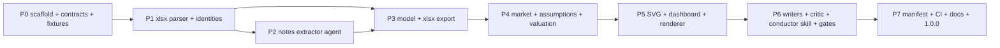

# Phases

There is one branch and one PR per phase (D28). A phase starts only after its predecessors are merged into `develop`.

The phases are strictly sequential. P2 needs the `sdp validate` command and the run directory that P1 builds.

| Phase | Branch | Deliverables | Out of scope |
|---|---|---|---|
| **P0** | `feature/p0-scaffold` | Plugin skeleton (`plugins/stock-deepdive-pro/`, `pyproject.toml`, `uv.lock`, `src/sdp/` with a CLI stub), marketplace entry, JSON Schemas for every contract in [CONTRACTS](CONTRACTS.md), `taxonomy/items.yaml` + an initial `synonyms.yaml`, fixtures for BGRIM and DITTO (§9), and a `facts.golden.jsonl` **template** with candidate values marked `verified_by: null` | Any parsing logic |
| **P1** | `feature/p1-parser` | `sdp new-run`, `fetch` (iDisc adapter ported from legacy, with ledger and fiscal year), `extract` (coordinate-aware xlsx dump, docx port, PDF scan fix), `parse` (statement detection, unit detection, synonym mapping, raw rows), unit sanity cross-check, `validate` with G1–G3 identities | Notes and 56-1 facts |
| **P2** | `feature/p2-notes-agent` | `agents/notes-extractor.md`, a schema-repair loop (validator errors fed back once), and `sdp validate` support for note facts. Run it against the fixtures and commit the reviewed output as a golden | Model math |
| **P3** | `feature/p3-model` | Period engine (YTD → quarter, TTM), metric registry (§4), `model.json`, `model.xlsx` with live formulas, G4 | Valuation |
| **P4** | `feature/p4-valuation` | `agents/market-collector.md`, `agents/assumptions-proposer.md`, `config/defaults.yaml`, `config/tickers/BGRIM.yaml`, `market-validate`, `valuation` (bands, peers, DCF, sensitivity, reverse DCF, 52-week range), G5 | Rendering |
| **P5** | `feature/p5-dashboard` | SVG chart library (football field, line/bar, heatmap), dashboard layout §8.4, reference substitution §8.1–8.2, provenance appendix, G6 (bare-number check), snapshot tests | Prose |
| **P6** | `feature/p6-writers` | `agents/writer.md` (one prompt, lane given at call time), `sections.md`, `agents/critic.md`, `prepare-writers`, the conductor skill `skills/deepdive/SKILL.md`, `skills/fetch/SKILL.md`, G0, G7 and G8, plus one revision loop | CI |
| **P7** | `feature/p7-release` | Complete `run.json` writer (timings, hashes, versions), GitHub Actions (`uv run pytest -m "not live"`), README for the plugin, an A/B comparison write-up against `lite` on BGRIM, version `1.0.0` | — |

## Version bumps
At the end of each phase, set `version` in `plugins/stock-deepdive-pro/.claude-plugin/plugin.json` to `0.<phase>.0`. P7 sets `1.0.0`.

## Definition of done (every phase)
1. Every acceptance command for the phase in [ACCEPTANCE.md](ACCEPTANCE.md) passes and its output is pasted into the PR body.
2. `uv run pytest -m "not live"` is green.
3. Nothing under `plugins/stock-deepdive-lite/` changed (`git diff --stat develop -- plugins/stock-deepdive-lite` is empty).
4. CONTRACTS changes, if any, come with a DECISIONS entry and a schema version bump.
5. The PR body lists: what was built, what was deferred and why, any spec ambiguity found, and how it was resolved (or a question for the reviewer).
