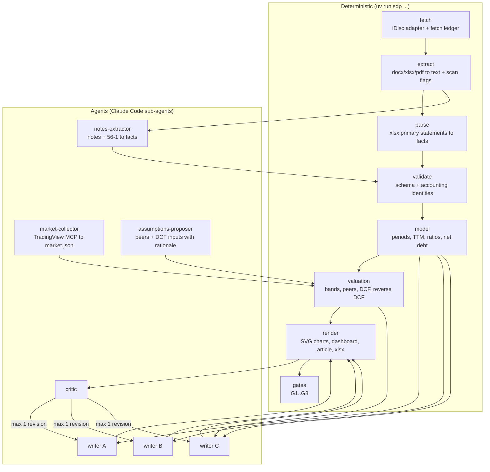

# SPEC — stock-deepdive-pro

Status: approved design (see [DECISIONS.md](DECISIONS.md)). Exact formats are in [CONTRACTS.md](CONTRACTS.md).

## 1. Goal

Given a Thai ticker, produce an **analyst-grade, fully traceable** deep-dive. Readers should be able to check every figure, a script should be able to recompute
every ratio, and the valuation must be explicit about its assumptions.

Deliverables per run:

1. `report.html` is offline and single-file, with two tabs:
   - **Dashboard**: KPI tiles, charts, football-field valuation, reverse-DCF box, assumptions panel.
   - **Article**: 10 sections in Thai. Every number links to its source.
2. `model.xlsx` is the financial model with live formulas.
3. `facts.jsonl` holds every extracted fact with provenance.
4. `model.json` holds every derived metric with its formula and inputs.
5. `run.json` is the run manifest: inputs, versions, timings, gate results.

## 2. Non-goals (v1)

- US or other markets. The adapter seam exists, but there are no implementations.
- Codex support.
- Analyst target prices, buy/sell/hold opinions, or price targets of our own.
- OCR of scanned pages. They are flagged and listed as unread.
- Real-time data. The market snapshot is taken once per run and dated.

## 3. Principles (non-negotiable)

| # | Principle | Mechanism |
|---|---|---|
| P1 | **No number in the output that does not come from a fact or a metric** | Writers cite `{{f:…}}` / `{{m:…}}`, and the renderer substitutes. Gate G6 fails on any bare number outside an allow-list |
| P2 | **Deterministic where possible** | Parsing primary statements, period derivation, ratios, valuation math, charts and HTML are all scripts. Agents do notes extraction, prose and critique |
| P3 | **One definition per concept** | Canonical items, metrics and tiers are defined once in CONTRACTS. Prompts reference them and never restate them |
| P4 | **Trust tiers are visible** | Every fact has a tier from one enum: `filed`, `management_statement`, `headline`, `secondary_market`, `computed`, `derived` |
| P5 | **Absence is stated** | Missing inputs produce explicit "not available because …" output, never silent gaps |
| P6 | **Anomaly ≠ intent; not investment advice** | Enforced in prompts and checked by the critic. A fixed disclaimer is rendered by the template |
| P7 | **Gates block** | Any failing gate stops delivery with a readable report (exit code 2) |
| P8 | **Reproducible** | `run.json` records input hashes, versions and assumptions. The same inputs give the same `model.json` |

## 4. Architecture

Orchestration: the `deepdive` skill is a **thin conductor**. It runs `sdp` subcommands in order, launches agents at the agent steps, and stops on any non-zero gate.
All state lives in the run directory ([CONTRACTS §1](CONTRACTS.md#1-directory-layout)).

## 5. Components

### 5.1 Source adapter (`sdp fetch`)
- Interface: `resolve(symbol) -> candidates[]`, `list_filings(entity) -> filings[]`, `download(filing) -> path`.
- v1 implementation: iDisc (ported from legacy `fetch_th.py`, with tests).
- Writes a **fetch ledger** (`fetch.json`) listing expected vs obtained documents, failures with reasons, and **fiscal year for each 56-1**. That year is parsed from the index row, not guessed from the file ID.
- Identity check: prints the registered company name. A collision or empty name is a G1 failure that needs user confirmation.

### 5.2 Extractor (`sdp extract`)
- docx: body-order linearisation with OLE-embedded workbooks inlined (port of legacy logic, which works).
- xlsx (text dump for agents): **must honour cell coordinates** (`r` attribute). The legacy version dropped empty cells and shifted columns.
- pdf: per-page text with `[[page N]]` markers. Scan detection flags a page if it falls below an absolute floor **or** below a relative cut. If more than 50% of pages are flagged, the whole document is flagged.
- Manifest lists **all** files, including unconvertible ones and their reasons.

### 5.3 Statement parser (`sdp parse`)
- Reads `FINANCIAL_STATEMENTS.xlsx` with `openpyxl` using cell coordinates.
- Detects per sheet:
  - statement type (BS/IS/CF/SE)
  - basis columns (consolidated / separate)
  - period headers (instant or duration, end date, length in months)
  - unit, from any of: a column header (`Baht`, `Baht ’000`), a sheet-corner label (`Thousand Baht`), or a title row
- Maps row labels to canonical items through `taxonomy/synonyms.yaml` (EN + TH). Unmapped rows become `raw.<slug>` facts.
- Confidence comes from validator identities ([CONTRACTS §7](CONTRACTS.md#7-gates)). A statement that fails falls back to the notes-extractor agent for that statement only.
- **Unit sanity:** compare each comparative column with the same item in the prior filing. A ratio of about 1000 means a mislabelled unit, which happened in BGRIM Q1/2026. Auto-correct it, record `unit_corrected: true` with the evidence, and surface it in `run.json`.

### 5.4 Notes extractor (agent)
- Input: the manifest, converted text, and a list of required note items ([CONTRACTS §3.4](CONTRACTS.md#34-note-items-agent-extracted)).
- Output: facts in the same schema, each with `source.page` or `source.line`. Hard cap of 80 facts. Validation errors are returned to the agent once for repair.

### 5.5 Model (`sdp model`)
- Period engine: derives discrete quarters and TTM from year-to-date data. Every derived value lists its input fact IDs.
- Metrics registry ([CONTRACTS §4](CONTRACTS.md#4-modeljson)): margins, growth, CFO/NI, FCF, net debt (two definitions: with and without perpetual debentures), leverage, coverage, payout, common-shareholder earnings, BVPS (with and without perpetuals).
- Exports `model.json` and `model.xlsx`. The xlsx has one sheet each for facts, periods, metrics, valuation and assumptions, and its formulas reference cells so they can be audited.

### 5.6 Market collector (agent) and `sdp market-validate`
- The agent uses TradingView MCP to collect price, shares, 5-year price history, multiples history if available, peers' multiples, and the Thai government bond yield. It writes `market.json`.
- The script validates the schema, dates and staleness (more than 7 days old is a warning). It fills nothing in.
- Fallback: if `market.json` is missing, valuation methods that need it are reported as "not available", and the dashboard says so.

### 5.7 Assumptions (`assumptions.yaml`)
- Per ticker, under `config/tickers/<TICKER>.yaml`. Defaults come from `config/defaults.yaml`.
- The assumptions-proposer agent may propose the peer set and DCF inputs **with a rationale per field**. Proposals are written to the run directory, and the user's file is never overwritten.
- `sdp valuation` range-checks every value (for example terminal growth must be below risk-free + 1%, and WACC between 4% and 15%).

### 5.8 Valuation (`sdp valuation`)
- **Bands:** historical P/E and P/BV percentiles (p25/p50/p75 over a lookback period) × current EPS/BVPS. The equity basis follows `equity_adjustments` (exclude perpetuals by default).
- **Peers:** EV/EBITDA min–max (and median) × own EBITDA → EV → minus net debt → per share.
- **DCF:** a FCFF projection driven by assumptions. The sensitivity grid is WACC × terminal growth. The football-field bar is the min–max of the grid's central 3×3.
- **Reverse DCF:** solve for the constant FCFF growth that makes the DCF equal to the current price, holding WACC and terminal growth fixed.
- **52-week range:** from market history.
- Output: `valuation.json` with every bar's low, mid, high, method, inputs and caveats.

### 5.9 Renderer (`sdp render`)
- Substitutes `{{f:id|fmt}}` and `{{m:id|fmt}}` in writer fragments. Each substituted number gets a tooltip and an anchor to the provenance appendix.
- **Charts (SVG):** football field, revenue and gross margin, CFO vs net income, net debt and finance cost, capacity operating vs pipeline (when the facts exist), and a sensitivity heatmap.
- Dashboard layout ([CONTRACTS §8](CONTRACTS.md#8-renderer-and-dashboard)), the article, a provenance appendix (every cited fact with file/page), and the disclaimer.
- Writes `report.html` (self-contained, < 2 MB) and `model.xlsx`.

### 5.10 Writers and critic (agents)
- 3 lanes, unchanged from legacy: A = §1–3, B = §4–6, C = §7–10. Character caps of 12k / 14k / 14k. Single pass.
- Input: `model.json`, `valuation.json`, `facts.jsonl`, and the section contract. **No access to `data/`.** The prompt states this, and the run directory given to writers contains only those files.
- Each lane also emits `claims-<lane>.jsonl` ([CONTRACTS §6](CONTRACTS.md#6-claims-and-critic)).
- Critic: reads the rendered article plus claims and returns a verdict (`pass | conditional | fail`) with located issues. On `fail` or `conditional`, the affected lanes get exactly one revision round, and the critic re-checks once. The final verdict is recorded and must not be `fail` (G7).

### 5.11 Gates (`sdp gate`)
G1–G8 are defined in [CONTRACTS §7](CONTRACTS.md#7-gates). Every gate writes a machine-readable result into `run.json` and a human summary to stdout.

## 6. Legacy defects the rebuild must not reintroduce

| Legacy defect (see `docs/reverse-engineering/`) | Prevented by |
|---|---|
| Number screen accepted fabricated values (scaled matching + absolute tolerance) | P1 reference substitution + G6 bare-number gate |
| Writer prompt told writers to open source files | Writers see only the run directory, and their prompt has no source paths |
| 10 vs 11 sections, 3 incompatible tier schemes | Single definitions in CONTRACTS, plus a lint check (G0) that prompts do not restate them |
| `critic` defined but never invoked | Critic is a mandatory step and G7 |
| Fully scanned PDF reported as readable | Absolute floor plus a whole-document flag (5.2) |
| xlsx empty cells dropped silently | Coordinate-aware reading (5.2, 5.3) |
| 56-1 years unlabelled; second 56-1 can be years old | Fiscal year in the fetch ledger and folder name. A gap warning |
| "Folder exists" treated as "fetched" | Fetch ledger + G1 |
| Mislabelled unit (BGRIM Q1/2026 "Baht" = thousands) | Unit sanity cross-check (5.3) |
| FACTS over its size cap; manual timing | Hard caps validated; `run.json` timings |
| Shared `_parts/` across tickers | Run directory per ticker and run ID |

## 7. Plugin packaging

- `plugins/stock-deepdive-pro/` with `.claude-plugin/plugin.json`, `skills/deepdive/`, `skills/fetch/`, `agents/*.md`, `src/sdp/` (Python package), `config/`, `taxonomy/`, `tests/`, `pyproject.toml`, `uv.lock`.
- The CLI entry point is `sdp`, invoked as `uv run --project "${CLAUDE_PLUGIN_ROOT}" sdp …`.
- Add it to `.claude-plugin/marketplace.json` next to `lite`. Leave the Codex marketplace untouched (D4).
- Version `0.N.0` where N is the last merged phase, then `1.0.0` at P7.
