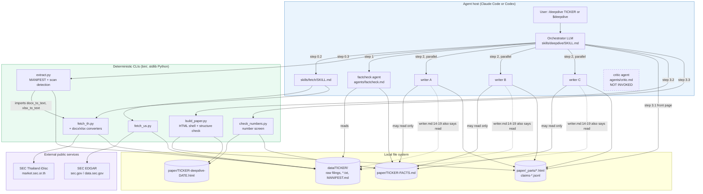
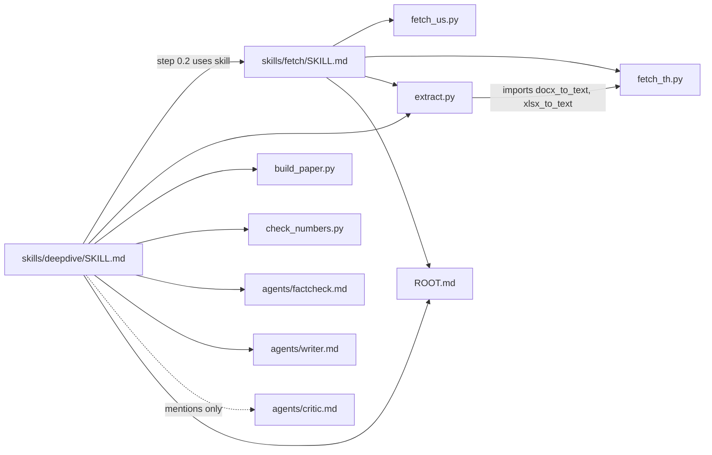

# Architecture

`P/` = `plugins/stock-deepdive-lite/`. Labels are defined in [README.md](README.md#evidence-labels).

## 1. Technology inventory

| Concern | What is used | Evidence |
|---|---|---|
| Language | Python 3 (README says 3.9+). Stdlib only: `urllib`, `zipfile`, `xml.etree`, `json`, `re`, `argparse`, `statistics` | `P/bin/fetch_us.py:20-26`, `P/bin/fetch_th.py:23-31`, `README.md:59` |
| Optional deps | `fitz` (PyMuPDF), else `pypdf`, imported lazily for PDF text | `P/bin/extract.py:53-72` |
| "Framework" | Claude Code plugin + Codex plugin. Skills and agents are Markdown with YAML front-matter | `P/.claude-plugin/plugin.json`, `P/.codex-plugin/plugin.json:20`, `P/skills/*/SKILL.md:1-4`, `P/agents/*.md:1-5` |
| Orchestrator | The host LLM session executing `skills/deepdive/SKILL.md` | `P/skills/deepdive/SKILL.md:78-91` |
| Persistence | Local file system only (`./data/`, `./paper/`). No database, queue or cache | `README.md:98`, `.gitignore:3-5` |
| External services | SEC EDGAR (4 endpoints), SEC Thailand iDisc (3 endpoints). HTTPS GET only | `P/bin/fetch_us.py:36-40`, `P/bin/fetch_th.py:41-43` |
| Output | One self-contained offline HTML file with inline CSS | `P/bin/build_paper.py:34-105,140-143` |
| Build / CI / tests | **None in repo.** Validation is manual via `claude plugin validate` and the Codex validator | `AGENTS.md:53-58` |

There are **no** HTTP routes, controllers, services, repositories, databases or queues (OBSERVED; checked by reading every file).
The usual web-app layering (`route → controller → service → DB`) maps onto this system as:

| Web-app role | Equivalent here |
|---|---|
| Route / entry point | Slash command or `$skill` mention, mapped to `SKILL.md` |
| Controller | The orchestrating LLM following the playbook steps |
| Services | Role agents (`factcheck`, `writer`×3) plus `bin/*.py` CLIs |
| Repository / DB | Directory tree `./data/<TICKER>/` and `./paper/` |
| External integrations | EDGAR and iDisc over HTTPS |

## 2. Architectural style

**Pipes-and-filters over files, orchestrated by an LLM** (INFERRED). Each stage reads and writes well-known paths:

```
fetch_* → data/<T>/{raw}  → extract → data/<T>/MANIFEST.md + *.txt
        → factcheck agent → paper/<T>-FACTS.md
        → 3× writer agents → paper/_parts/{10-a,20-b,30-c}.html + claims-*.jsonl
        → orchestrator     → paper/_parts/05-front.html
        → build_paper      → paper/<T>-deepdive-<date>.html
        → check_numbers    → console report (or --out .md)
```

Supporting patterns:

- **Deterministic core with an imperative LLM shell** (OBSERVED). Anything with a fixed answer goes to a script (`SKILL.md:19-21`, `AGENTS.md:30-34`). Judgement work goes to agents.
- **Single source of truth for numbers** (OBSERVED, `SKILL.md:15-17`). `FACTS.md` is the only allowed number source for writers.
- **Scatter–gather** (OBSERVED, `SKILL.md:118-126`). Three writer lanes run in parallel, split by workload rather than by topic count (`:33-34`). Results are gathered by filename order (`build_paper.py:163`).
- **Template ownership** (OBSERVED, `SKILL.md:39`, `build_paper.py:5-7`). Agents emit `<section>` fragments with a fixed CSS class vocabulary. The script owns the shell, CSS and disclaimer.
- **Host adapter by documentation** (OBSERVED, `P/ROOT.md`). The same content serves two hosts. Path resolution is described in prose, and the skills show two command lines (`SKILL.md:45-50`).

## 3. Component diagram



Source: [diagrams/architecture.md](diagrams/architecture.md). The dashed edge marks the documented isolation leak (finding 2).

## 4. Boundaries and responsibilities

| Boundary | Inside | Contract crossing it | Enforced by |
|---|---|---|---|
| Network ↔ local | `fetch_us.py`, `fetch_th.py` | Raw files under `data/<T>/` with deterministic names | Code (OBSERVED) |
| Raw ↔ readable | `extract.py` (+ converters in `fetch_th.py`) | `*.txt` siblings plus `MANIFEST.md` | Code |
| Source documents ↔ numbers | `factcheck` agent | `FACTS.md` table (7 columns) | **Prompt only** (`SKILL.md:97-114`) |
| Numbers ↔ prose | `writer` agents | "numbers only from FACTS", `[คำนวณ]` marker for computed values | **Prompt only**, plus a weak script screen (`check_numbers.py`) |
| Fragments ↔ document | `build_paper.py` | `<section>` fragments, no `style=`, class whitelist | Code for `style=`, tag balance and external `src`. **Prompt only** for the class whitelist |
| Plugin ↔ host | Manifests + `ROOT.md` | `<ราก>` resolution, `${CLAUDE_PLUGIN_ROOT}` | Documentation |

**INFERRED, the key architectural property:** the system's hardest guarantees (no fabricated numbers, writer isolation,
trust tiers, no buy/sell advice) sit at prompt-enforced boundaries. Only presentation-level invariants are mechanically enforced.

## 5. Module dependencies



The only code-level import is `P/bin/extract.py:31-32`, which inserts its own directory into `sys.path` and imports from `fetch_th`.
Every other link is "a playbook tells the LLM to run X".

## 6. Tradeoffs

### Scalability
- One ticker per run, with sequential HTTP and fixed sleeps: 0.2 s for EDGAR (`fetch_us.py:48`), 0.4 s for iDisc (`fetch_th.py:55`). Fetch time is dominated by downloads (REPORTED 4.2 min, `README.md:118`). That is acceptable for an interactive tool and was never designed for batch use (INFERRED).
- The parallelism sits in the LLM lanes, and wall time equals the slowest lane (`SKILL.md:23`). Without sub-agents the run degrades to serial, 60–75 min (`SKILL.md:86-91`, REPORTED).
- `companyfacts.json` is held fully in memory (`fetch_us.py:111-119`). Large filers are tens of MB (INFERRED), which is fine.

### Reliability
- **No retries or backoff** on any HTTP call (`fetch_us.py:45-54`, `fetch_th.py:53-57`). Per-document failures are printed and skipped (`fetch_us.py:193-194,206-207`; `fetch_th.py:295-297`).
- **Partial state looks complete.** The playbook decides whether to fetch by directory existence (`SKILL.md:54`), and no completeness marker is written.
- **One failure aborts the rest of the 56-1 downloads.** The download inside the 56-1 loop has no per-item guard (`fetch_th.py:328`), so a single failure skips the remaining items via the outer handler (`:346-347`).
- `extract.py` is idempotent: it re-converts and overwrites every run (`:123-127`, `:188`).
- `build_paper.py` writes the output **before** validating it (`:190-192` then `:200-205`), so a structurally broken file is left on disk with exit 2.

### Security
| Surface | Observation | Risk (INFERRED) |
|---|---|---|
| Remote zips | `zipfile.extractall` on iDisc downloads (`fetch_th.py:301-302,332-333`). Python's `zipfile` strips absolute paths and `..` components (stdlib documentation, external fact), but there are no size or ratio limits | Low: a zip bomb from a government host is unlikely |
| Untrusted XML | `xml.etree.ElementTree.fromstring` on docx/xlsx parts (`fetch_th.py:91,97,105,164,200`) | Low, given modern expat entity-expansion limits |
| Prompt injection | Filing text is read verbatim by LLM agents (`factcheck` has `Bash` and `Write`, `P/agents/factcheck.md:4`). Nothing sanitises or fences it | **Medium**: a filing or exhibit could carry instructions. The rules in `AGENTS.md` are the only defence |
| HTML assembly | `<title>` is escaped (`build_paper.py:173`), but `--title`, `--subtitle` and `--sources` are inserted **raw** into `<h1>`, `<p>` and the footer (`:176,179,185`). `clean_fragment` strips `<script>`/`<style>`/`<head>` but not `on*=` handlers, `<iframe>` or `javascript:` URLs (`:113-121`). The external-reference check only covers `src="https://…"` (`:140-141`) | Low: the content is the user's own LLM output viewed locally |
| Identity leakage | The SEC contact email goes into the User-Agent (`fetch_us.py:156`). This is required by SEC policy | By design |
| Data licensing | Only public, no-login sources (`README.md:150`, `P/skills/fetch/SKILL.md:79`) | By design |

### Maintainability
- **Two manifests per host** have to stay in sync by hand (`AGENTS.md:42-47`). Nothing validates parity.
- **Instruction drift across prompts.** The writer prompt, playbook, README and slides disagree on topic count, tiers and isolation (findings 2, 3, 5, 6). There is no single schema for "section", "tier" or "FACTS row".
