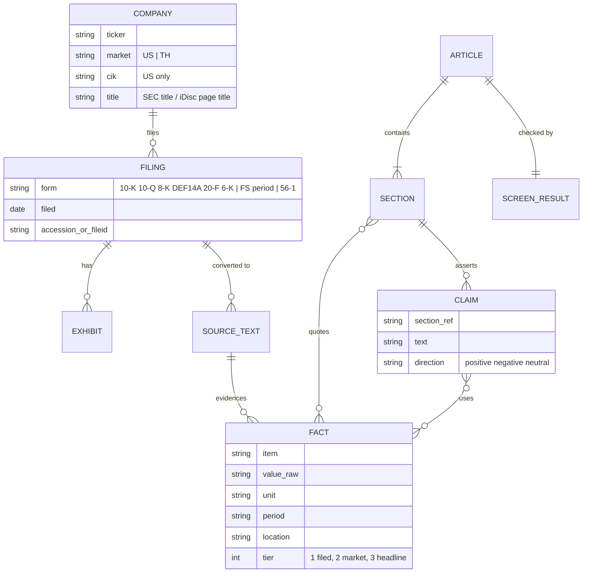

# Data Models

The system has no database. Its data model is **a directory layout plus four text formats**. Every format is defined by prose in a
prompt or by a writer function in a script. Nothing validates them, apart from the narrow checks noted below.

## 1. File-system schema

```
./data/<TICKER>/                          created by fetch_* (default path; --out overrides)
|  US (fetch_us.py)
|-- companyfacts.json                     raw XBRL companyfacts                      fetch_us.py:115-116
|-- companyfacts_index.txt                "== taxonomy (n) ==" + "  tag<TAB>label"   :121-129
|-- <FORM>_<YYYY-MM-DD>_<ACCN>.<ext>      primary doc, FORM with "/"→"-"              :188
|-- <FORM>_<DATE>_<ACCN>_<EXTYPE>.<ext>   8-K/6-K exhibit, EXTYPE stripped of . / sp  :200-201
|  TH (fetch_th.py)
|-- FS_<YYYYMM>_<name20>/                 one financial-statement period              :290-291
|   |-- AUDITOR_REPORT.docx|.doc (+ .txt) docstring: fixed package layout             :7-9
|   |-- FINANCIAL_STATEMENTS.xlsx (+ .txt)
|   `-- NOTES.docx (+ .txt)               embedded workbooks inlined in .txt
|-- R561_<YYYYMM>_<name20>/               56-1 One Report (≤2)                        :324-326
|   `-- *.pdf (+ .txt with [[หน้า N]])     .txt written by extract.py
|  both
`-- MANIFEST.md                           written by extract.py                       extract.py:188

./paper/
|-- <TICKER>-FACTS.md                     factcheck agent                             SKILL.md:97
|-- _parts/
|   |-- 05-front.html                     orchestrator                                SKILL.md:156
|   |-- 10-a.html  20-b.html  30-c.html   writer lanes                                SKILL.md:124-126
|   `-- claims-<lane>.jsonl               writer lanes                                SKILL.md:136
`-- <TICKER>-deepdive-<date>.html         build_paper.py                              SKILL.md:168
```

- **Ordering is part of the schema.** `build_paper.py` concatenates `*.html` sorted by name (`:163`), so the numeric prefixes decide section order. `claims-*.jsonl` is not `.html`, so it is not included.
- **Ownership.** `data/` and `paper/` are git-ignored as user data (`.gitignore:1-4`).
- **Not namespaced by ticker:** `paper/_parts/`. Two tickers built in the same working directory share and overwrite one parts folder (DERIVED from the fixed path in `SKILL.md:124-126,167`).

## 2. `FACTS.md`: the central fact table

Defined only in `P/skills/deepdive/SKILL.md:97-114`. One Markdown table, one number per row:

| Column | Type | Constraints (from prompt) |
|---|---|---|
| `#` | int | Row number |
| `รายการ` (item) | text | e.g. "net profit", "OCF" |
| `ค่า` (value) | number as written | **Raw**, never unit-converted (`:111-112`) |
| `หน่วย` (unit) | text | As the document states (พันบาท, ล้านบาท, USD millions…) |
| `งวด` (period) | text | e.g. FY2568, Q2/2569 |
| `ไฟล์ + ตำแหน่ง` (file + location) | text | Path plus page or line or note number |
| `ชั้น` (tier) | 1 / 2 / 3 | 1 = filed / annual report · 2 = secondary market data · 3 = headline (`:103-104`) |

Required coverage (`:107-109`): balance sheet, income statement, OCF vs NI for every period, segment revenue, related-party transactions,
commitments and contingencies, major shareholders, executive pay. Size: 80–120 rows (`:106`). Conflicts: both values recorded with a flag (`:114`).
There is no column for the conflict flag (INFERRED: it must go into the item or value text).

**How `check_numbers.py` reads it:** every numeric token in the whole file, regardless of column (`check_numbers.py:87`).

## 3. `claims-<lane>.jsonl`

Defined in `SKILL.md:136-141`. One JSON object per line, 8–15 per lane, "only debatable claims":

```json
{"หัวข้อ": "5.2", "ข้อความ": "...", "ทิศ": "บวก|ลบ|กลาง", "ตัวเลขที่ใช้": ["..."]}
```

| Field | Meaning | Domain |
|---|---|---|
| `หัวข้อ` | Section reference | `"<section>.<sub>"` string |
| `ข้อความ` | The claim | Free text |
| `ทิศ` | Direction | `บวก` positive · `ลบ` negative · `กลาง` neutral |
| `ตัวเลขที่ใช้` | Numbers used | Array of strings, intended to be FACTS values |

Consumer: the orchestrator in step 3.4 (`:192-194`). No script reads it.

## 4. `MANIFEST.md`

Written by `P/bin/extract.py:148-188`:

```
# สารบัญเอกสาร — <folder name>
สร้างโดย `extract.py` เมื่อ <ISO date>
| ไฟล์ต้นทาง | ไฟล์ที่อ่านได้ | ตัวอักษร | หมายเหตุ |
| `<src>` | `<txt>` | <chars> | "ตารางฝัง N ตาราง" | "<pages> หน้า · เป็นภาพสแกน k หน้า: 3-5, 9" | "อ่านไม่ได้" |
## 🔴 หน้าที่เป็นภาพสแกน …        (optional)  - `<pdf>` หน้า <ranges>
## ไฟล์ที่แปลงเป็นข้อความไม่ได้       (optional)  - `<.doc/.xls>`
```

Rows exist only for `.docx`, `.xlsx` and `.pdf`. US `.htm` filings and `companyfacts*` never appear (`:123-146`).

## 5. Converted text conventions (`*.txt`)

| Marker | Producer | Meaning |
|---|---|---|
| `===== ชีต: <name> =====` | `xlsx_to_text` (`fetch_th.py:139`) | Sheet boundary |
| Tab-separated cells | `_table_lines`, `_xlsx_sheets` | One table or sheet row per line |
| `----- ตารางฝัง #n (<file>) -----` … `----- จบตารางฝัง -----` | `_embedded_table_lines` (`:180,187`) | Embedded workbook inlined at its position |
| `[ชีต: <name>]` | `:184-185` | Named sheet inside an embedded workbook |
| `===== ตารางฝังที่ตามตำแหน่งในเนื้อความไม่ได้ (n) =====` | `:228` | Embedded workbooks with no position in the text |
| `[[หน้า N]]` and an optional `⟨ภาพสแกน — ข้อความไม่ครบ⟩` | `pdf_to_text` (`extract.py:85-87`) | PDF page boundary and scan flag |
| `[แปลงไม่ได้: …]`, `[อ่าน PDF ไม่ได้ — …]` | converters | Conversion failure written *into* the `.txt` |

## 6. In-memory records

| Record | Fields | Source |
|---|---|---|
| Filing pick | `form, accn, date, doc` | `fetch_us.py:78-79` |
| Exhibit | `(name, type)` | `fetch_us.py:101-104` |
| Fetch plan | `{form: count}`. Domestic: 10-K 2 · 10-Q 4 · 8-K 6 · DEF 14A 1. Foreign: 20-F 2 · 6-K max(6,4) | `:172-174` |
| MANIFEST row | `(src, dst, chars, note)` | `extract.py:129-130,143` |
| Orphan | `(line_no, raw_token, context[:110])` | `check_numbers.py:106` |

## 7. Domain entities (conceptual)



Source: [diagrams/data-model.md](diagrams/data-model.md). Relationships with FACT are *intended* (prompt-level). Nothing links a section's numbers to row IDs:
the screen matches by value, not by reference (INFERRED; the root cause of BR-02).
