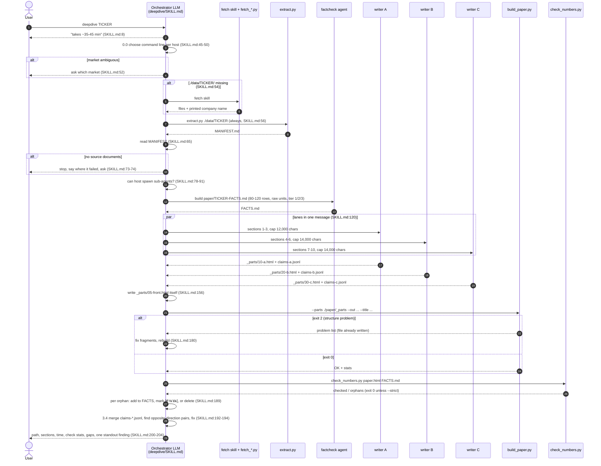
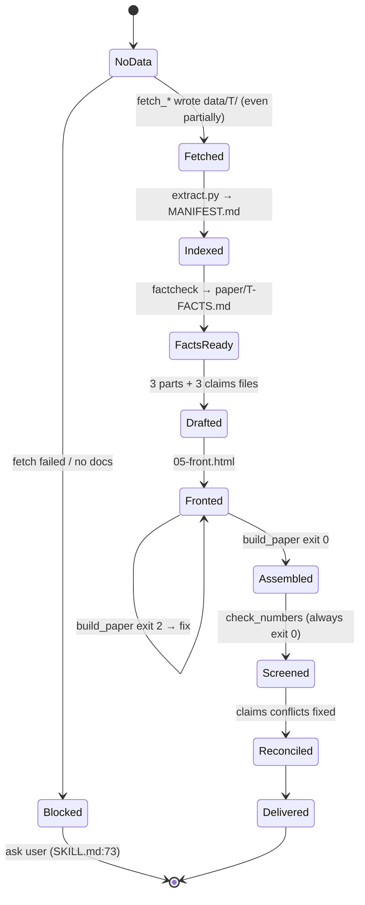
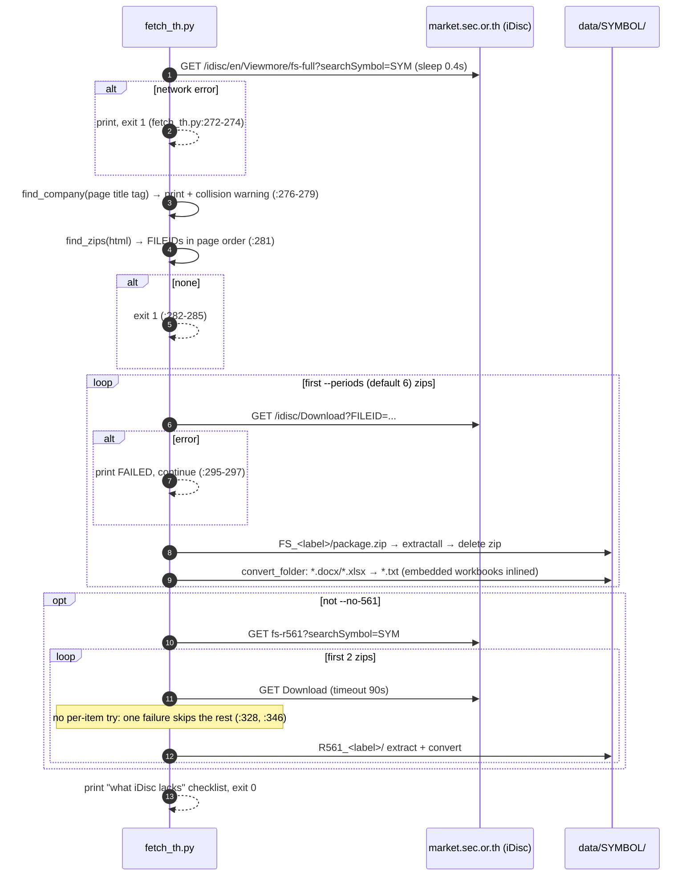
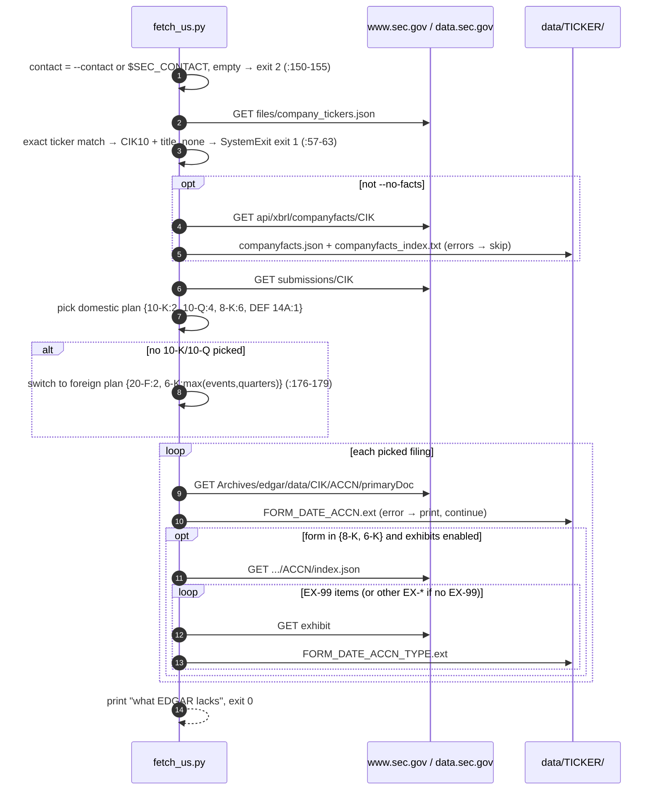

# Execution Flows

`P/` = `plugins/stock-deepdive-lite/`. All script execution is **synchronous and single-threaded**. The only concurrency
is the three writer agents launched "together in one message" (`P/skills/deepdive/SKILL.md:84,120`).

## F1. `/stock-deepdive-lite:deepdive <TICKER>`: end to end

Source: [diagrams/deepdive-sequence.md](diagrams/deepdive-sequence.md)

**Degraded mode** (OBSERVED, `SKILL.md:86-91`). If the host cannot spawn sub-agents, the orchestrator runs lanes A → B → C itself,
reading `agents/writer.md` as its own instructions. It must still write all `claims-*.jsonl` files, and it tells the user the run will take 60–75 min.

**Not in the flow** (OBSERVED, bounded search): the `critic` agent. The factcheck agent is used once, to *produce* FACTS. It is never used to
audit the finished article, even though its prompt is written for that (`P/agents/factcheck.md:15,52-59`).

### Implicit run state machine

The run has no explicit state. Its state is implied by which artefacts exist (Rosetta "implicit state machine", INFERRED):

Source: [diagrams/pipeline-state.md](diagrams/pipeline-state.md). Two consequences follow:

- `Fetched` is entered even after partial failure, and later runs skip fetching because the folder exists (`SKILL.md:54`).
- `Screened` cannot fail unless `--strict` is passed, and the playbook never passes it (`SKILL.md:185-186`, `check_numbers.py:147`).

## F2. `fetch_th.py <SYMBOL>`: Thai filings from iDisc

Source: [diagrams/fetch-th-sequence.md](diagrams/fetch-th-sequence.md)

## F3. `fetch_us.py <TICKER>`: US filings from EDGAR

Source: [diagrams/fetch-us-sequence.md](diagrams/fetch-us-sequence.md)

## F4. `extract.py <folder>`

1. Recursively walk `folder` in sorted order (`extract.py:118`).
2. `.docx`/`.xlsx`: convert with `fetch_th`'s converters, overwrite `<stem>.txt`, and count embedded tables by marker (`:123-130`).
3. `.pdf` (case-insensitive, unless `--no-pdf`): extract text per page with PyMuPDF, falling back to pypdf. Prefix `[[หน้า N]]`. Flag pages whose length is below `min(150, median×0.15)` (`:82-83`).
4. `.doc`/`.xls`: list as unconvertible (`:145-146`).
5. **Everything else (`.htm`, `.json`, `.txt`) is ignored** and does not appear in MANIFEST (OBSERVED).
6. Write `MANIFEST.md`: a table, plus a "scanned pages" section and an "unconvertible" section (`:148-188`). Exit 0. Exit 1 if the folder is missing.

## F5. `build_paper.py`

1. Collect `--parts/*.html` and sort by filename (`:163`). Ordering is a naming convention: `05-front`, `10-a`, `20-b`, `30-c`.
2. Header: tags (escaped), `<title>` (escaped), `<h1>` and subtitle (**raw**) (`:168-179`).
3. Body: each fragment passes through `clean_fragment`, which strips doctype/html/head/style/script and anything outside `<body>` (`:124-130`).
4. Footer: sources (raw), date and fixed disclaimer (`:183-187`).
5. **Write the file**, print stats, **then** `check()`. Problems give exit 2 (`:190-205`).

## F6. `check_numbers.py report facts`

1. Tokenise **all** of FACTS.md, including the `#`, period, file and line-reference columns, into a float list (`:87`).
2. For each report line, skip headings, separator rows and blank lines (`:95-96`). Skip the whole line if it contains `[คำนวณ]` (`:97-99`).
3. For each number token: skip noise, which is anything below 100 without a comma, or a bare year 1900–2100 / 2400–2700 (`:50-58`).
4. Match under scales ×{1, 1e3, 1e-3, 1e6, 1e-6} with tolerance `max(|t|×0.6%, 1.0)` (`:61-68`).
5. Print the summary and up to 15 orphans. Exit 0, or exit 1 only with `--strict` (`:147`).

When run on HTML, lines are raw markup. Inline CSS lives in `<head>` as one `<style>` element whose content spans
many lines (`build_paper.py:174`), so hex colours such as `#141f2b` yield the token `141`. These are then "matched" via the ×1e-3 scale (DERIVED).

## Error handling and exit codes (consolidated)

| Script | Condition | Behaviour | Line |
|---|---|---|---|
| `fetch_us.py` | No contact | stderr message, **exit 2** | 151-155 |
| | Ticker not in SEC list | `SystemExit(msg)` → **exit 1** | 63 |
| | No supported filings | `SystemExit(msg)` → exit 1 | 180-181 |
| | companyfacts fetch fails | Warn, continue | 110-114 |
| | Filing or exhibit fetch fails | Warn, continue | 193-194, 206-207 |
| | `index.json` fails | Warn, no exhibits | 85-89 |
| `fetch_th.py` | Index page fails | **exit 1** | 272-274 |
| | No zips | exit 1 | 282-285 |
| | Period download fails | Warn, continue | 295-297 |
| | Zip extraction fails | Keep raw zip, still try conversion | 307-308 |
| | Any 56-1 error | Abort all 56-1, warn | 346-347 |
| `extract.py` | Folder missing | exit 1 | 111-113 |
| | No PDF library | Recorded in MANIFEST, warn | 64-68, 138-139 |
| `build_paper.py` | No parts dir / no `.html` | exit 1 | 160-166 |
| | Structure problems | **exit 2** (output already written) | 200-205 |
| `check_numbers.py` | Missing file / no numbers in FACTS | exit 2 | 82-90 |
| | Orphans | exit 0, or 1 with `--strict` | 147 |

**Retries:** none anywhere. **Timeouts:** EDGAR 30 s (`fetch_us.py:49`), iDisc 40 s, or 90 s for 56-1 (`fetch_th.py:53,328`).
**State changes:** only file writes. No deletions apart from the downloaded `package.zip` after a successful extract (`fetch_th.py:303,334`).
