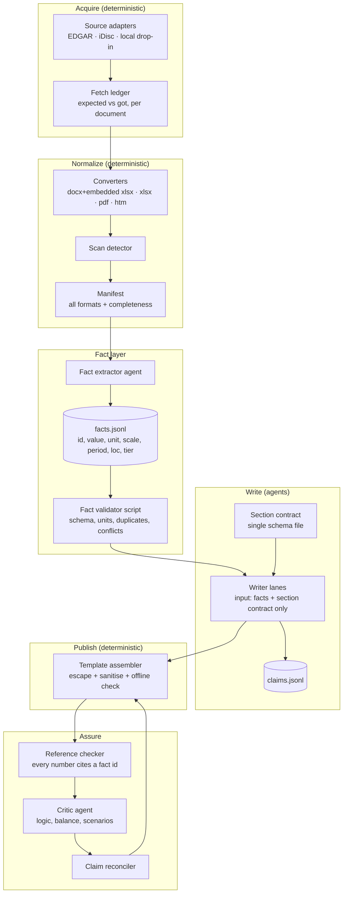

# Clean-Room Reimplementation Blueprint

This describes **what** to build and **why**, at the architecture level. No source code from the reference has been copied.
Anything that looks like an interface below is written fresh, in neutral notation.

## 1. Essential vs incidental

Applying Rosetta's "would we rebuild this?" filter:

| Keep (domain-essential) | Drop or replace (implementation-incidental) |
|---|---|
| Regulator-filed documents as the only primary source | Regex scraping of the iDisc HTML for `FILEID=` (keep the need for discovery, not the method) |
| Fact table as the single number gateway, with raw value, unit, period, location and tier | The FACTS table being Markdown parsed by "every number in the file" |
| Embedded-workbook recovery from Thai notes | Hand-rolled ZIP/XML only if a dependency-free install is a hard requirement |
| Scan-page detection so absent text is not mistaken for absent facts | The `min()` cutoff formula |
| Parallel writer lanes split by workload, with a claim log for cross-lane reconciliation | Lane boundaries hard-coded to sections 1–3 / 4–6 / 7–10 |
| Template-owned output shell, fragments with a class vocabulary, offline single file | The specific dark-theme CSS |
| Editorial rules: absence stated, tiers separated, anomaly ≠ intent, "what must you believe", scenario validity, no advice | Rules duplicated across 4 prompt files with drift |
| Host portability (two agent hosts) | Two hand-synchronised manifest pairs |

## 2. Target architecture

Source: [diagrams/blueprint.md](diagrams/blueprint.md)

## 3. Component contracts

### 3.1 Source adapter
- **Input:** market and identifier. **Output:** a document set plus a **fetch ledger** listing each expected document as `ok | failed(reason) | absent-at-source`.
- Retries with exponential backoff on 429/5xx. Honour SEC's fair-access guidance (declared UA with a contact, ≤10 requests/s).
- Identity resolution returns a **candidate list**: name, registry ID and listing status. The adapter never silently picks one when a ticker collides (a gap in the reference, BR-17).
- Include amendments (`10-K/A`) as a separate, labelled category instead of excluding them implicitly.
- The ledger replaces "folder exists ⇒ fetched".

### 3.2 Converters
- One converter per format, all emitting the same marked-up text: page markers, table rows, embedded-table blocks with their source position.
- **docx:** walk body order, inline OLE-embedded workbooks where they are referenced, and list unplaced ones. The reference's insight (ADR-08) is the core requirement.
- **xlsx:** apply number formats or emit the format next to the value, so percentages and dates are not ambiguous.
- **htm (EDGAR):** strip the markup to text with table rows preserved. This closes the gap where US filings are absent from the manifest.
- Legacy `.doc/.xls`: optionally delegate to LibreOffice headless when it is present. Otherwise list the file as unconvertible, as the reference does.

### 3.3 Scan detector
Flag a page when its text length is below an **absolute floor** (around 150 chars) **or** below a fraction of the document median. In addition,
flag the **whole document** when the majority of its pages are under the floor. This fixes probe P3b, where a fully scanned PDF reported nothing.

### 3.4 Fact store (replaces Markdown FACTS)
- Records with a stable **`id`**, item, `value_raw`, `unit`, `scale` (a normalised multiplier from the unit), period, location and tier.
- **Tier enum, one definition for the whole system:** `filed`, `management_statement`, `headline`, `secondary_market`, `computed`. This resolves I-3.
- Conflicts are first-class: a `conflicts_with: [id]` field (BR-04).
- A validator script checks schema, enum values, the size budget and duplicate items per period.
- The human-readable Markdown table is **generated** from the store, never parsed back.

### 3.5 Writers
- Input: the fact store, the section contract and the class vocabulary. **No access to `data/`.** The reference only *asks* for this, and its writer prompt contradicts the request. Enforce it by giving writers a working directory that contains only the facts file, or by restricting tools where the host allows it.
- Every number in prose carries a fact reference, such as an inline marker `{{f:42}}` or an attribute on a ``. The assembler renders the number from the store. **This makes BR-01 mechanically checkable by reference, instead of by value matching.**
- Computed values reference their input fact IDs together with the operation, and the checker recomputes them.

### 3.6 Assurance
- **Reference checker:** fail the build if any rendered digit sequence is not produced from a fact reference or from an allow-listed literal (section numbers, years in headings). This is a strict gate, not a sieve.
- **Critic:** wire in the existing role. The reference defines it (`P/agents/critic.md`) but never invokes it.
- **Claim reconciler:** validate the claims schema, then group claims by section and topic and surface opposite-direction pairs to the orchestrator.

### 3.7 Template assembler
- Escape every CLI-supplied string. Sanitise fragments with an allow-list of tags and attributes instead of a deny-list, which closes the gaps around `on*=`, `iframe` and `javascript:` URLs.
- Validate **before** writing, or write to a temporary file and rename on success.
- Namespace the parts directory by ticker and run ID.

## 4. Fixing the number screen (if the reference design is kept)

If value matching stays instead of the reference model in §3.5, the following changes close most of the hole:

1. Parse only the value column, and use the unit column to compute each fact's absolute value.
2. Normalise report numbers by the unit word that follows them (พันบาท, ล้าน, million…) instead of trying every scale.
3. Use a relative tolerance only, with no absolute floor after scaling.
4. Check numbers below 100 when they have decimals or are followed by `%`.
5. Make `[คำนวณ]` cover a span or element, not the whole physical line.
6. Make the playbook run the screen in strict mode, so it gates the delivery.

## 5. Single source for prompts

Put one **contract file** in the repository: section list, tier enum, FACTS schema, lane split, caps and CSS classes. The playbook, writer, factcheck and critic
prompts reference it instead of restating it. A lint script then fails the build on drift, for example when a prompt says "11 topics". This addresses I-1 through I-9.

## 6. Host portability

- Generate both manifest pairs from one source file. The current ones are hand-synchronised per `AGENTS.md:42-47`.
- Keep the reference's "show both literal command lines" solution (ADR-13). The commit history shows the placeholder-only approach failing in practice.
- Have a smoke command, `<tool> --help`, before the first real step, as `P/ROOT.md:36-42` already does.

## 7. Alternatives considered

| Decision point | Reference | Alternative | Trade-off |
|---|---|---|---|
| Orchestration | LLM follows Markdown playbook | Python driver calling LLM APIs per role | Deterministic control flow and retries, but loses host-native UX and sub-agent tooling, and needs API keys |
| Fact format | Markdown table | JSONL plus a generated Markdown view | Machine-checkable, but slightly harder for agents to write. Mitigate with a validator loop |
| Office parsing | Hand-rolled zip/XML | `python-docx`/`openpyxl` plus a custom OLE walk | Fewer edge-case bugs, but adds install friction |
| PDF | PyMuPDF/pypdf optional | OCR scanned pages (Tesseract) | Recovers auditor reports, but adds heavy dependencies and OCR error risk. Keep it opt-in |
| Lanes | 3 fixed | Dynamic lanes sized by fact count and section weight | Better balance, but more orchestration complexity |

## 8. Licensing and third-party constraints

| Item | Status | Implication |
|---|---|---|
| Reference repo | MIT, © 2026 boonchu (`LICENSE`) | Reuse is permitted with notice. This blueprint copies no code regardless |
| PyMuPDF | AGPL-3.0 or commercial (external fact, verify current terms) | Optional runtime import is fine for a local tool. **Bundling or redistributing it in a service triggers AGPL obligations.** Prefer pypdf (BSD) as the default if you redistribute |
| pypdf | BSD-3-Clause (external fact) | Permissive |
| SEC EDGAR data | Public, with fair-access policy: declared UA and rate limit (external fact; reflected in `fetch_us.py:12-13,48`) | Keep a contact UA and throttling |
| iDisc (market.sec.or.th) | Terms of use not examined (**UNKNOWN**) | Review the portal's terms before redistributing fetched documents |
| Generated articles | Contain excerpts and figures from filings | Keep the "educational, not advice" disclaimer (BR-08). Do not republish full filings |
